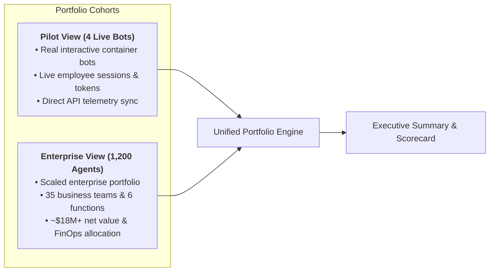
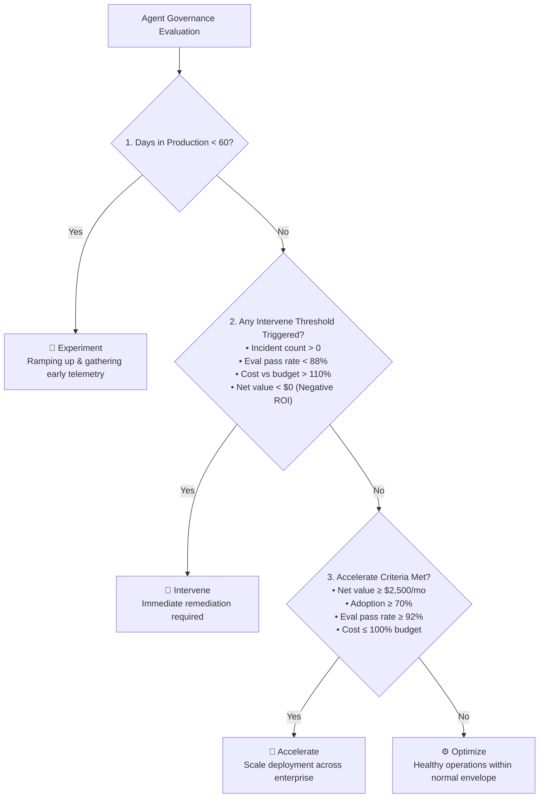
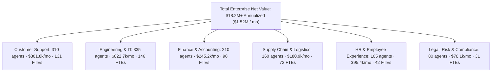

# WCT AI Cockpit — Enterprise vs. Pilot Metrics & Governance Architecture Guide

> **Target Audience:** Executive Leadership, Client Pitch Teams, FinOps Engineers, Product Managers  
> **Cockpit Version:** 2.1.0 Enterprise Production  
> **Status:** Authoritative Reference Manual  

---

## 1. Executive Summary: Dual-Cohort Architecture

The **WCT AI Cockpit** operates on a **Dual-Cohort Mode** selectable via a single-click toggle in the global header:

```
[ Enterprise View (1,200) ]  ↔  [ Pilot View (4) ]
```



### Cohort Comparison Matrix

| Dimension | Pilot View (4 Agents) | Enterprise View (1,200 Agents) |
| :--- | :--- | :--- |
| **Primary Purpose** | Hands-on client proof-of-concept, real bot execution, live token and telemetry demonstration. | Demonstrates macro organizational impact, labor capacity unlocking, and FinOps governance at Fortune 500 scale. |
| **Agent Count** | **4 Live Agents** (1 in IT, 1 in Supply Chain, 1 in Finance/AP, 1 in HR). | **1,200 Autonomous Agents** spread across 35 enterprise teams and 6 core business functions. |
| **Telemetry Source** | Live database telemetry (`user_usage`, `agent_usage_daily`, live Azure OpenAI sessions). | Live telemetry for the 4 core pilots + mathematically consistent deterministic enterprise telemetry for the remaining fleet. |
| **Net Value Scale** | ~$1.2k – $3.5k / mo (pilot stage). | **~$18.2M+ Annualized Net Value** (~$1.52M / mo). |
| **Hours Saved** | ~120 – 350 hours / mo. | **~83,345 hours / mo** (~520 FTEs unlocked). |
| **Live Link Buttons** | Active `[Live Agent ↗]` links to real container web UIs (Copilot Studio, IT Service Desk). | Live links restricted strictly to the live demo bots; other agents show clean enterprise fleet telemetry. |

---

## 2. Agent Governance Decision Matrix

Every autonomous agent in the AI Cockpit is continuously audited and assigned one of four governance statuses. The rules are evaluated sequentially in the exact order below:



### Governance Status Rules Table

| Status | Trigger Condition / Parameter | Business Meaning & Executive Action |
| :--- | :--- | :--- |
| **🧪 Experiment** | `Days in Production < 60 days` | **Early Stage Ramp-Up:** Recently deployed agent. Telemetry is being collected; thresholds are not yet penalized for lower initial adoption. |
| **🚨 Intervene** | Triggered if **ANY** of these fail:<br>• `Policy Incidents > 0`<br>• `Cost vs Budget > 110%`<br>• `Eval Pass Rate < 88%`<br>• `Net Value < $0` (Negative ROI) | **Immediate Risk Remediation:** Triggered by safety/hallucination incidents, runaway LLM token costs, poor accuracy, or value destruction. Opens the root-cause diagnostics drawer. |
| **🚀 Accelerate** | `Net Value ≥ $2,500/mo` **AND** `Adoption ≥ 70%`<br>*(with Eval Pass ≥ 92% and Cost ≤ 100% budget)* | **High-ROI Scaling Candidate:** Proven top performer. Outperforms on value generation, human adoption, and quality. Recommended for expansion into other business units. |
| **⚙️ Optimize** | Operates safely within normal envelope (`Eval ≥ 88%`, `Cost ≤ 110%`, `Incidents = 0`), but net value is under the `$2,500` threshold to qualify for Accelerate. | **Standard Healthy Production:** Performing well within operational bounds. Focus is on fine-tuning prompt latency, semantic caching, and token budgets. |

---

## 3. Mathematical Value & Financial Formulas

The AI Cockpit does not rely on arbitrary mock numbers. Every figure is derived from transparent, defensible labor economics and FinOps principles:

### A. Hourly Labor Rate ($/hr)
To calculate the monetary value of an employee's time saved by an AI agent:

$$\text{Hourly Labor Rate} = \frac{\text{Fully-Burdened Monthly Employee Cost}}{\text{Standard Monthly Working Hours}}$$

* *Default Parameters:*
  * Fully-burdened monthly cost: **$6,500.00**
  * Standard working hours: **160 hours / month**
  * $\text{Standard Hourly Rate} = \frac{\$6,500}{160} = \mathbf{\$40.63\text{ / hour}}$
  * *(Customizable per team, e.g., \$85.00/hr for Tier-1 IT Support Engineers, \$95.00/hr for Cloud SREs).*

---

### B. Labor Hours Saved (Capacity Unlocked)
Hours returned to employees to perform higher-value strategic tasks:

$$\text{Hours Saved} = \text{Successful Agent Sessions (Eval Passed)} \times \text{Baseline Human Task Duration}$$

* *Example:*
  * Ticket Triage Agent resolves **117 IT tickets** successfully.
  * Human baseline to triage, assign, and draft response: **0.25 hours (15 minutes)**.
  * $\text{Hours Saved} = 117 \times 0.25\text{ hrs} = \mathbf{29.25\text{ hours}}$.

---

### C. Gross AI Value Created ($)
The economic productivity generated before deducting compute costs:

$$\text{Gross AI Value} = \text{Hours Saved} \times \text{Hourly Labor Rate}$$

* *Example:*
  * $29.25\text{ hours saved} \times \$40.63\text{/hr} = \mathbf{\$1,188.43}$.

---

### D. Actual AI Cost ($)
True FinOps cost covering model token consumption plus dedicated cloud infrastructure:

$$\text{Token Consumption Cost} = \left(\frac{\text{Prompt Tokens} \times \text{Input Price}}{1,000,000}\right) + \left(\frac{\text{Completion Tokens} \times \text{Output Price}}{1,000,000}\right)$$

$$\text{Actual Monthly AI Cost} = \text{Token Consumption Cost} + \text{Monthly Dedicated Infrastructure Cost}$$

* *Default LLM Pricing (Azure OpenAI GPT-4o / Sonnet standard):*
  * Input tokens: **$2.50 per 1M tokens**
  * Output tokens: **$10.00 per 1M tokens**
  * Infra cost: Dedicated container memory/CPU compute allocation (e.g. $45.00/mo).

---

### E. Net AI Value Created ($)
The true bottom-line economic return delivered to the business:

$$\mathbf{\text{Net AI Value} = \text{Gross AI Value} - \text{Actual AI Cost}}$$

* *Example:*
  * Gross Value: **$1,188.43**
  * Actual AI Cost: **$70.19**
  * $\text{Net AI Value} = \$1,188.43 - \$70.19 = \mathbf{\$1,118.24}$.

---

### F. Value Multiple (ROI per $1 Spent)

$$\text{Value Multiple} = \frac{\text{Gross AI Value}}{\text{Actual AI Cost}}$$

* At the enterprise scale of $597.3k monthly spend vs $2.75M gross value:
  * $\text{Value Multiple} = \frac{\$2,750,000}{\$597,300} = \mathbf{4.6\times\text{ Return (for every \$1 spent, \$4.61 in labor capacity is generated)}}.$

---

### G. Workforce Adoption Rate (%)

$$\text{Workforce Adoption} = \left(\frac{\text{Active Employees Using Agent in Month}}{\text{Total Assigned / Licensed Department Employees}}\right) \times 100\%$$

* Target benchmark: **≥ 70%** (indicates healthy integration into day-to-day employee workflows).

---

### H. Evaluation Pass Rate (%)

$$\text{Eval Pass Rate} = \left(\frac{\text{Successful Executions (Eval Passed)}}{\text{Total Executed Sessions (Eval Runs)}}\right) \times 100\%$$

* Enterprise Benchmark: **≥ 92%** (Target: Green)
* Warning Threshold: **< 88%** (Triggers Intervene status)

---

## 4. Enterprise Fleet Calculation Breakdown (1,200 Agents)

When pitching to prospective clients and C-level stakeholders, the Enterprise View shows how 1,200 autonomous agents scale across an enterprise:



### The 4 Enterprise FinOps Pillars (Cost Allocation)

In the **Cost & Budget** dashboard, total monthly spend (**$597.3k**) is distributed across the 4 foundational enterprise FinOps pillars:

| FinOps Pillar | Monthly Spend | Share (%) | Primary Drivers |
| :--- | :---: | :---: | :--- |
| **Model Token Consumption** | **$328.1k** | **55%** | Raw LLM prompt & completion inference across customer support deflection, code generation, and contract extraction. |
| **Platform & Infrastructure** | **$143.2k** | **24%** | Dedicated Azure Container Apps, GPU clusters, Kubernetes node pools, and microservice hosting. |
| **Vector RAG & Knowledge Pipelines** | **$77.5k** | **13%** | Enterprise knowledge indexing, vector database queries (Pinecone / Azure AI Search), and chunk re-ranking. |
| **AI Safety, Governance & Guardrails** | **$47.7k** | **8%** | PII redaction, prompt injection firewalls (NeMo Guardrails), hallucination evaluators, and audit compliance logging. |

---

## 5. Client Pitching Best Practices (Cheat Sheet)

> [!TIP]
> **Pitch Rule 1: Start with the Enterprise View, then zoom into the Pilot View.**  
> Show the client the macro impact first ($18M+ value, 520 FTEs capacity, healthy FinOps envelope). Then click **Pilot View (4)** to show how individual bots directly interface with enterprise systems (SAP, ServiceNow, Copilot Studio) with live telemetry.

> [!IMPORTANT]
> **Pitch Rule 2: Clean, Enterprise-Level Agent Titles.**  
> Never show messy developer tags, bracketed team strings like `[Customer Support #2]`, or internal model identifiers (`gpt-4o-mini`, `claude-3-5-sonnet`) during an executive pitch. The Cockpit automatically normalizes all titles (e.g. *Subscription Cancellation Triage II*) for executive readability.

> [!NOTE]
> **Pitch Rule 3: Explaining "Optimize" vs "Intervene".**  
> If an executive asks why a live bot is in **Optimize**:  
> *"Optimize is the target healthy steady state. It means zero safety incidents, evaluation accuracy is above 92%, and costs are well under budget. As workforce adoption scales past $2,500/mo net value, the system automatically elevates it to Accelerate."*
