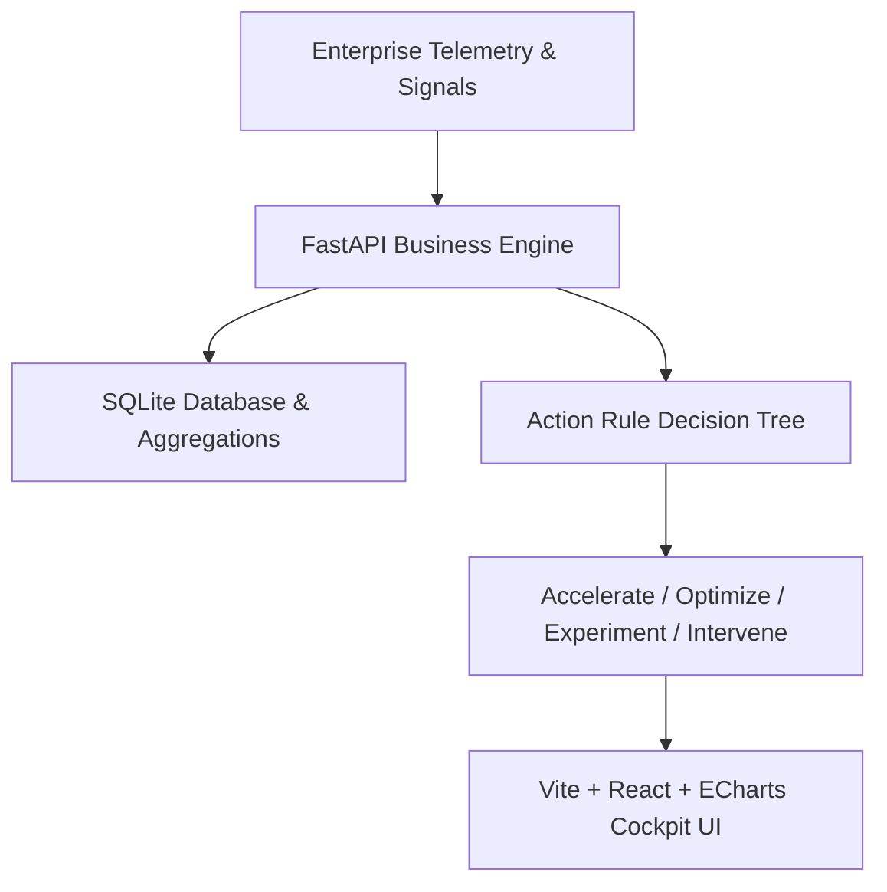

# WCT AI Value & Performance Management Cockpit

> **Enterprise AI Performance, Telemetry & Capital Allocation Platform**  
> Answers the 5 critical questions for executive leaders: *How much value does AI create? What does it cost? Who is adopting it? Is it safe and high quality? Where must we intervene?*

---

## 🏛️ Architecture Overview

The WCT AI Value Cockpit is structured as a high-velocity, role-based telemetry and decision-support engine:



### Core Stack
- **Frontend**: Vite 5 + React 18 + TypeScript + Apache ECharts + Vanilla CSS Design System
- **Backend API**: FastAPI (Python 3.12) + Pydantic v2 + JWT Role-Based Auth
- **Database**: SQLite with precomputed analytical view (`v_agent_scorecard_monthly`) and WAL mode
- **Infrastructure**: Docker Compose with lightweight zero-external-db setup

---

## 🚀 Key Dashboard Capabilities

### 1. Executive Summary
- **4 Core KPI Hero Cards**: Net Value Delivered ($1.80M/mo), Total AI Cost ($412K/mo), Value-to-Cost ROI Multiple (5.38x), Production Agents (44 active).
- **Net Value by Business Function**: Granular breakdown across Customer Operations, Engineering & IT, Finance, Operations, and Sales.
- **Cost Factor Composition**: Licences, Inference Consumption, Platform, Build/Run, and Enablement.
- **6-Month Progression Trajectory**: Realization curve tracking hours saved and return on capital.
- **Priority Intervention Backlog ("Where to Act")**: Automated detection of agents exceeding budget, dropping below the 88% eval pass bar, or logging safety incidents.

### 2. Agent Portfolio Scorecard
- **Quadrant Scatter Map**: Interactive Value vs. Adoption distribution map.
- **Sortable Heatmap Matrix**: Filter by function, posture, search query, or telemetry threshold.
- **Deep-Dive Telemetry Drawer**: Click any agent to inspect prompt evaluations, loaded hourly rates, days in production, and remediation recommendations.

### 3. FinOps: Cost & Budgeting
- **Team-Level Variance**: Actual expenditure vs. CFO allocations by engineering and operational pods.
- **Waterfall Factor Analysis**: Detailed accounting across token inference, dedicated host compute, and license pools.

### 4. Seats & Adoption Governance
- **Inactivity Bands**: Active (7-day), Lapsing (7-29 day), and Idle (30+ day) user segmentation.
- **Interactive License Reclaim Calculator**: Real-time modeling of direct EBITDA savings recovered from automated seat harvesting.

### 5. Admin & Rules Engine
- **Configurable Decision Thresholds**: Admin-editable trigger values for the 4 action postures.
- **CSV Data Ingestion**: Bulk file ingestion for agent runs, FinOps ledgers, and license inventories.

---

## 🛠️ Quick Start Guide

### Option A: Run with Docker Compose (Recommended)

```bash
# Clone and enter the repository
git clone https://github.com/WCTHLS/AI_Cockpit.git
cd AI_Cockpit

# Start FastAPI backend and Vite frontend
docker compose up --build
```

- **Cockpit Frontend**: [http://localhost:5173](http://localhost:5173)
- **FastAPI OpenAPI Swagger**: [http://localhost:8000/api/v1/docs](http://localhost:8000/api/v1/docs)
- **SQLite Database**: `backend/db/cockpit.db` (auto-initialized from `backend/db/init.sql`)

---

### Option B: Local Development Setup

#### 1. Backend Setup
```bash
cd backend
python -m venv .venv
# On Windows:
.venv\Scripts\activate
# On Linux/macOS:
# source .venv/bin/activate

pip install -r requirements.txt
uvicorn app.main:app --reload --port 8000
```

#### 2. Frontend Setup
```bash
cd frontend
npm install
npm run dev
```

---

## 🔒 Role-Based Personas (Built-in Demo Accounts)

Switch roles instantly using the top-bar persona selector:
| Persona | Email | Scope & Access |
|---|---|---|
| **CXO / Chief Executive** | `cxo@wct.com` | Enterprise-wide portfolio view across all business functions |
| **VP of Engineering** | `eng_head@wct.com` | Automatically scoped to *Engineering & IT* agents and pods |
| **Lead FinOps Analyst** | `finops@wct.com` | Prioritizes budget overage, token costs, and license recovery |
| **Cockpit Administrator** | `admin@wct.com` | Access to rule threshold calibration and CSV data ingestion |

---

## 📅 10-Day Sprint Roadmap (Team of 3-4 Devs)

- **Days 1–2: Foundation & Data Contracts**  
  DB schema locked, FastAPI endpoints verified, Pydantic contracts agreed, mock telemetry loaded.
- **Days 3–5: Core Cockpit & Visualizations**  
  Executive Summary KPI cards, ECharts integration, interactive agent scorecard matrix.
- **Days 6–7: FinOps & License Harvesting Engine**  
  Cost variance engine, seat inactivity bands, interactive reclaim calculator.
- **Days 8–9: Rule Decision Engine & CSV Upload**  
  Live threshold modification, agent state recalculations, automated file ingest.
- **Day 10: Executive Demo Hardening & Pilot Handover**  
  Cross-browser verification, latency benchmarks, stakeholder presentation walkthrough.

---

## 📄 License & Confidentiality
Strictly Confidential — WaferWire Cloud Technologies (WCT) © 2026. All rights reserved.
